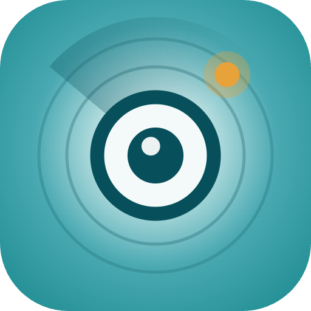
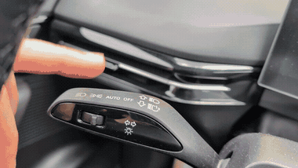
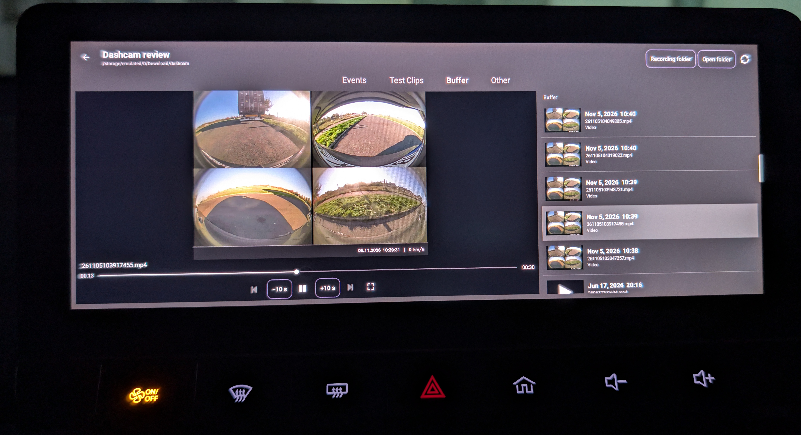
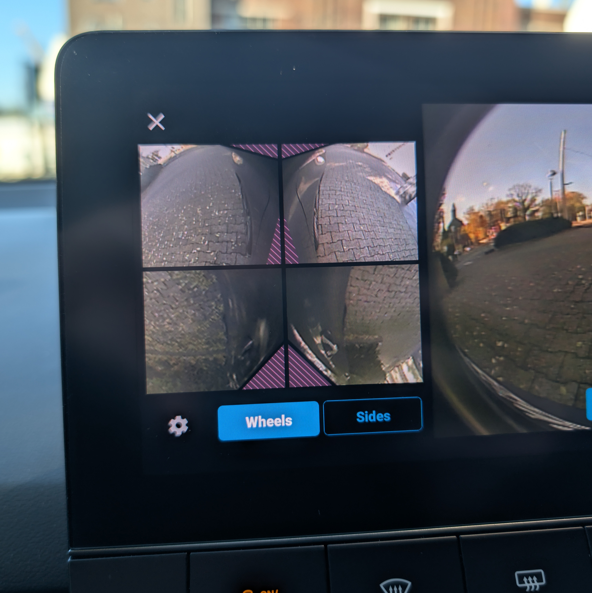
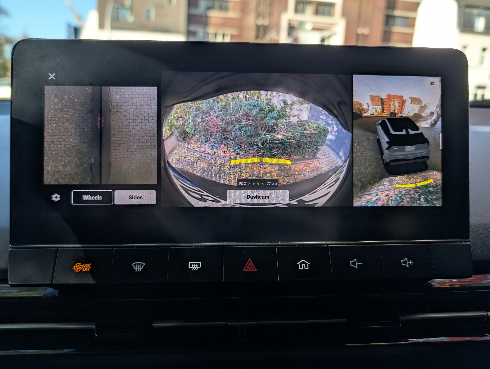
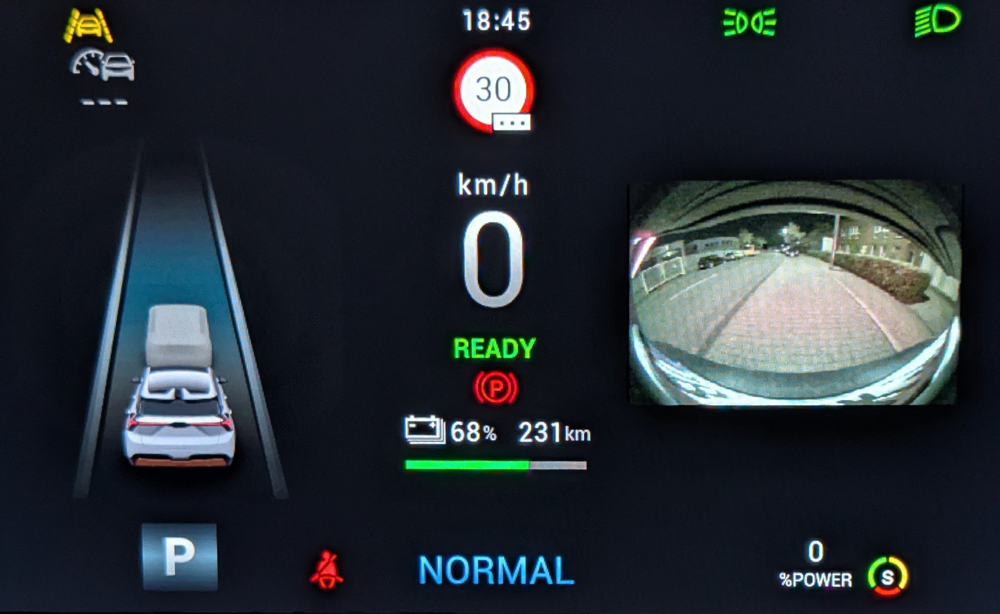
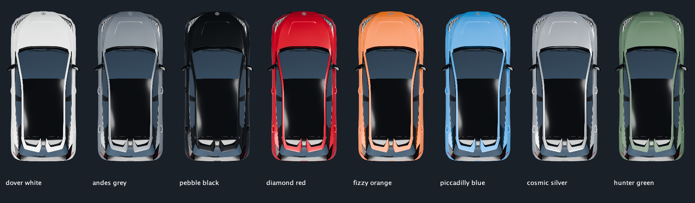

**2D/3D surround view, parking camera tools and a native four-camera dashcam for the MG4 EV.**

A community camera mod for the MG4 EV (AAOS 9, pre-2026 facelift), featuring live bird's-eye and interactive 3D views, dedicated wheel and side views, rear PDC overlays, and selectable MG4 paint colors. It also includes Tesla-style turn-signal camera overlays, a digital rearview mirror for the infotainment and instrument cluster, and native four-camera recording with event capture.


<br clear="left">

<p align="center">
  
  <a href="https://github.com/jamakr4/MG4-360-Camera-App/releases"></a>
  
  
  <a href="LICENSE"></a>
  
  
</p>

<p align="center">
  
  
  
  
  
</p>

<p align="center">
  <a href="https://github.com/jamakr4/MG4-360-Camera-App/wiki"><strong>Wiki</strong></a>
  &nbsp;·&nbsp;
  <a href="https://github.com/users/jamakr4/projects/4"><strong>Project Board</strong></a>
  &nbsp;·&nbsp;
  <a href="https://github.com/jamakr4/MG4-Dashcam-Trigger"><strong>Dashcam Companion App</strong></a>
  &nbsp;·&nbsp;
  <a href="https://github.com/jamakr4/MG4-Digital-Rearview-Trigger"><strong>Digital Mirror Companion App</strong></a>
  &nbsp;·&nbsp;
  <a href="https://www.youtube.com/watch?v=HyrV3ExR3aA&amp;t=7s"><strong>Demo Video 1</strong></a>
  &nbsp;·&nbsp;
  <a href="https://www.youtube.com/watch?v=gccuZU6uf3M"><strong>Demo Video 2</strong></a>
</p>

> [!CAUTION]
> **Never rely solely on the camera views or on-screen overlays.** Always check your surroundings directly and use your mirrors. Camera images and overlays may be delayed, distorted, incomplete or unavailable. You remain responsible for safe driving, parking and operating the vehicle.
>
> **Use at your own risk.** To the extent permitted by applicable law, the authors and contributors accept no liability for accidents, injuries, property damage or other losses arising from use of this app.

<p align="center">
  <a href="https://github.com/jamakr4/MG4-360-Camera-App/releases/latest"></a>
  <a href="https://github.com/jamakr4/MG4-360-Camera-App/releases"></a>
</p>

<h2 align="center">Lane change? No problem!</h2>

<p align="center">
  Signal left or right and the matching camera appears automatically in a Tesla-style tile overlay. Move it, resize it or choose a compact view to fit your screen. Also without the original speed-based auto-close behavior.
</p>

<p align="center">
  
  
</p>


<h2 align="center">Native four-camera dashcam? Sure!</h2>

<p align="center">
  Record all four factory cameras in one combined clip, with time, speed and your own footer signature. Save to a USB drive or internal storage, keep a rolling buffer, capture a single test clip or save an event when it matters. A movable, color-coded status indicator shows recording activity, pauses and errors. Review footage on scene with the integrated player!
</p>

<p align="center">
    
</p>

<p align="center">
  <a href="https://www.youtube.com/watch?v=HyrV3ExR3aA&amp;t=7s">▶ Daylight demo on YouTube</a>
  &nbsp;·&nbsp;
  <a href="https://www.youtube.com/watch?v=gccuZU6uf3M">▶ Night demo on YouTube</a>
</p>


<h2 align="center">Curbed wheels? Let's avoid that!</h2>

<p align="center">
  Four wheel close-ups and two full-side views help you judge the gap to the curb. Adjust the front and rear wheel views independently and choose the correction mode that suits your parking view.
</p>

<p align="center">
  
  
</p>

<h2 align="center">The whole picture. In 2D, 3D & AR.</h2>

<p align="center">
  See all four cameras together in a bird's-eye view or explore the interactive 3D surround view. Drag to orbit or pinch to zoom! See rear parking-sensor feedback directly in the reversing camera.
</p>

 

<h2 align="center">Trunk full of cargo? Digital Rearview to the rescue!</h2>

<p align="center">
  Keep the rear camera in view even when luggage blocks the rear window. Show the digital mirror on the infotainment screen, the driver instrument cluster or both.
</p>

<p align="center">
  
</p>


<h2 align="center">Your MG4. Your color.</h2>

<p align="center">
  Choose from eight paint finishes in <strong>Parking</strong> for both the 2D bird's-eye and 3D surround views.
</p>

<p align="center">
  
</p>

<h2 align="center">Many other cool features!</h2>

- **OEM 360 AVM coexistence**: can briefly yield camera access so the stock reverse/360 view still opens when needed.
- **Full Screen**: the app hides the (side) navigationbar and also the top bar on demand to get extra space.
- **External trigger support**: send `com.drivehub.kamera.action.TRIGGER_DASHCAM_EVENT` from ADB or another app to save an event clip. Compatible [MG4Control](https://github.com/SliDeeN/MG4Control) versions also support direct `App function` shortcuts for **Save dashcam event** and **Toggle digital rearview**.
- **Experimental surveillance recording**: compatible MG4Control versions can start a separate recording session for up to two hours, then restore the previous dashcam setting.
- **Auto language selection**: English, German, French and Czech (cs-CZ) are selected automatically from the vehicle language.

> [!NOTE]
> Some features may only be available in the latest beta version.


## Installation Instructions

<details>
<summary><strong>Install via ADB</strong></summary>

1. Download the latest signed APK from [GitHub Releases](https://github.com/jamakr4/MG4-360-Camera-App/releases/latest).
2. Install the latest [Android SDK Platform Tools](https://developer.android.com/tools/releases/platform-tools) on your computer and make sure the `adb` command is available.
3. Enable ADB in both places on the MG4 head unit:

   - Enable ADB in **Engineering Mode**.
   - Open the Android **Developer options** and enable **USB debugging** there as well.

   Enabling ADB in Engineering Mode alone is not sufficient.
4. Reboot the Android system if ADB is not available immediately after changing both settings.
5. Connect your computer to the USB Type-C port at the front of the MG4 head unit. If the head unit asks whether to allow USB debugging, accept the prompt.
6. Verify the connection:

   ```shell
   adb devices
   ```

   The head unit must appear with the status `device`. If it appears as `unauthorized`, accept the USB debugging prompt on the head unit and run the command again.
7. Install or update the app, replacing the example path with the path to the downloaded APK:

   ```shell
   adb install -r "/path/to/MG4-360-Camera-App-vX.Y.Z-release.apk"
   ```

   A successful installation ends with `Success`. The `-r` option updates an existing installation while preserving its app data.
8. Open **MG4 Camera Mod** using the app launcher of your choice. I personally use [Smart Edge](https://github.com/Imtiaz-Official/Smart-Edge).

> ⚠️ **Software-version compatibility**
>
> MG has restricted access to the Android system in newer R versions. On SWI68, general Android access may require R69 or earlier, while ADB access may require R67 or earlier.
>
> On newer SWIs, such as SWI 133, updates are delivered through SIPS and downgrading via USB is no longer possible. If you rely on sideloaded apps, confirm that ADB access will remain available before updating the FICM to a newer R version.

</details>

<details>
<summary><strong>Install via USB</strong></summary>

1. Download the latest signed APK from [GitHub Releases](https://github.com/jamakr4/MG4-360-Camera-App/releases/latest) and copy it to a USB drive.
2. Connect the USB drive to either the front USB Type-A or USB Type-C port.
3. Open the **Files** app on the vehicle's Android system and select the USB drive.
4. Select the APK and tap **Install**. If prompted, allow the Files app to install unknown apps.
5. Open **MG4 Camera Mod** using the app launcher of your choice.

> 💡 **Community video guide**
>
> A community member has shared a [video walkthrough of the USB installation process](https://photos.google.com/share/AF1QipNN8yK7XlK_kuZsqp4CMPORAWdtBpp5-LYftlxs43aQ5HNDJsTlL3q0TtYsMThhIQ?key=RjRsWUZBX1pHajR4Z3ZjdGR4dVJNR0lQTW1idlRn). This video was not created or maintained by the project author and is provided as an independent community resource. Its steps may not reflect future software versions, so compare them with the written instructions above.

> ⚠️ **Software-version compatibility**
>
> MG has restricted access to the Android system in newer R versions. On SWI68, general Android access may require R69 or earlier.
>
> On newer SWIs, such as SWI 133, updates are delivered through SIPS and downgrading via USB is no longer possible. If you rely on sideloaded apps, confirm that Android and USB installation access will remain available before updating the FICM to a newer R version.

</details>

> [!NOTE]
> **R-version upgrades**
>
> Sideloaded apps on the MG4 are usually stored in `/data`. Following MG's complete USB update procedure, including the final factory reset, deletes `/data` and all sideloaded apps. Some users preserve their apps by omitting the final factory reset, but doing so deviates from MG's instructions and may have side effects. For newer MG4s receiving R-version updates through SIPS, there is currently no known way to prevent this data loss.

> [!CAUTION]
> **Performing downgrades**
>
> Remember that you are working on a high-value vehicle, not a disposable device. Follow only instructions written for your exact hardware and software version, and proceed only if you fully understand the process. An incorrect downgrade may leave the FICM unusable or cause other unforeseen problems. This process is not approved or supported by MG. You have been warned.

## Quick Guides

**App display**

The app uses the full screen width, with the SAIC side navigation hidden in the app and its dialogs. Under `Settings` → `Display`, **Show status bar** controls the top SAIC status bar; it is shown by default. The choice is saved and applies immediately, including while Settings is open. Swipe inward from a screen edge to temporarily reveal the hidden system controls.

<details>
<summary><strong>Parking (main view)</strong></summary>

The main screen has a left camera panel, the single-camera preview in the center, and an experimental **2D/3D surround view** on the right. Select **Wheels** for four wheel close-ups (front wheels above, rear wheels below), or **Sides** for two tall side views. The selected mode is saved.

In reverse, rear PDC reads all four sectors together from the OEM system property `arcsoft.avm.mPdcBackObsShow`, with minimum distance from `arcsoft.avm.mBackObsClosestDistance` and status from `arcsoft.avm.ID_PDC_FRONT_REAR_STS`. An unknown or invalid sector hides only its own bar; valid sectors remain visible. Missing minimum distance retains the existing estimated level positions. These properties depend on the stock `CarManagerServer` publishing vehicle data.

Under **Parking → MG4 vehicle color**, eight color circles select the pre-rendered vehicle graphic (white, grey, black, red, orange, blue, silver or matte Hunter Green). The selection is saved and applies immediately to the Birdseye view.


Color previews are screen approximations. Artwork: **MattDoesBlender**, adapted and rendered under **CC BY-NC-SA 4.0**; see [image attribution](images/ATTRIBUTION.md).

The 2D view places a black rectangle beneath the vehicle artwork by default to hide camera artifacts in the vehicle footprint. **Parking → Black background under car (2D)** turns it off immediately for both Normal and Wide, revealing the camera image through transparent areas around the artwork. The choice is saved across app restarts and leaves 3D rendering unchanged. The Birdseye Debug Activity exposes the same toggle beside its view controls for direct comparisons. The ground beneath the actual vehicle is not reconstructed.

The 2D ground view requires the vehicle calibration at `/configure/camera_calibdata.bin` and current images from the four existing camera sessions. Missing calibration or camera images are shown explicitly. Its physical calibration, seams and recording performance still require vehicle testing; see [implementation and verification](docs/BIRDSEYE_2D_TEST.md) and the separate [offline preview](tools/birdseye/README.md).

The right main panel starts in **2D** and can switch to **3D**. The adjacent **Wide / Normal** button switches the 2D field of view and remembers the selection. Normal uses the flat ground plane; Wide samples the Rivela bowl from above at twice the visible width and height, retaining a 4 m flat floor around the body for the distance guides. The adjacent Horizontal Distribute icon toggles the driving path in both 2D and 3D and remembers the choice; the path starts enabled. The output retains the existing `TextureView` and owned EGL thread, with coalesced display-driven renders. Drag to orbit, pinch to zoom, double-tap to reset. The eight Parking paint swatches apply immediately to both views, including matte Hunter Green in 3D; the black roof and other vehicle details remain unchanged. All 3D paint palettes are prepared in the app and share the same articulated model. Both views share the existing four camera sessions and use only the actual vehicle calibration at `/configure/camera_calibdata.bin`.

The 3D wheels steer with the vehicle; speed-dependent rolling is disabled. The 3D front wheels and the 2D/3D blue track area use the shared OEM steering-curve/radius model with separate left/right wheel angles. The blue area uses the MG4’s 2060 mm width including mirrors as a visual width allowance; this does not alter the steering curve or the track used for the wheel angles. Steering Float `0x21601563` is read through the legacy SAIC `CarSensorManager`, with a `CarPropertyManager` fallback on newer systems. The area appears automatically in **2D and 3D** for **R** or **D**, using the existing read-only gear property `arcsoft.avm.mCurCarGear`. It is hidden in P/N, when gear or steering reads expire, or when the corresponding rear/front camera frame is unavailable. Missing steering holds the last wheel pose and hides the track. The 2D area uses the existing metric ground projection and is drawn below the vehicle artwork, including its mirrors and alpha silhouette. **The central camera image receives no new guidance overlay.** Dev Status reports the raw input, source, target wheel angles and gear; the old provisional scale/inversion controls have been replaced by the shared model.

**Parking → Guidelines 2D/3D** provides a speed threshold, enabled by default at **25 km/h**. With the filter on, guides remain visible at the threshold, hide above it and return automatically below it; missing or stale speed also hides them. The main path button remains the independent on/off choice. **Lines** draws four light-blue clearance curves at **2060 mm mirror width**; **Simple** retains the mirror-width outer edges and translucent fill and is the default. These choices persist and apply to R/D in Normal, Wide and 3D. Guides build over **350 ms** in driving direction (D: rear to front; R: front to rear) and retract along the same sweep when the speed filter or path button hides them. Quick toggles reverse from the current position. When a path is already visible, direct D↔R changes blend the complete outgoing and incoming paths simultaneously on one 350 ms clock instead of replaying the build sweep; quick gear reversals continue from both current opacities. Invalid steering/gear or camera freshness still removes the prediction immediately. Both styles retain the **700 mm end fade**, including each of the four individual lines. The Debug Activity starts with the saved style (Simple by default), uses the same light-blue mirror-width curves and reveal, and offers P/R/D selection, a local speed-threshold test checkbox plus simulated speed in 2D and 3D. In Debug, P retracts the visible guidance over 350 ms; switching back during retraction continues from the current position. The selection survives recreation.

Short camera gaps in **Normal, Wide and 3D** retain each camera's last uploaded image for up to **2 seconds**, independently of other cameras. The first returning image is uploaded immediately. Guidance, PDC and handoff readiness still require frames no older than **500 ms** and no more than **150 ms** behind the newest camera. Ownership loss and renderer errors invalidate the output immediately.

The OEM steering curve ends at **±516.95°**. Successful, fresh sensor readings up to **±540°** are accepted and saturated at that curve endpoint, so a small full-lock overshoot does not hide the R/D guidelines or extrapolate the steering geometry. The ±540° bound is a software plausibility tolerance, not a measured Extended Range steering limit. Dev Status retains the original raw reading. Non-finite values, larger readings, property errors and expired reads still hide guidance.

The **Birdseye debug activity** uses the same model and offers a manual slider over ±516.95°, presets, radius diagnostics, opt-in live readings, an interruption test and blue-area versus individual-line comparison in both 2D and 3D. The test-speed slider exercises the guideline speed threshold in 2D and 3D; live mode uses the shared vehicle-motion snapshot. The live 3D floor extends 4 m from the vehicle so guide endpoints remain on flat projected ground. **The D rear curves are visual guides joining the front endpoints, not physical rear-wheel trajectories.** The assumed 1450 mm effective track and existing mesh registration still need vehicle validation.

If 3D falls back to 2D, the message identifies camera projection, model/textures, memory, depth buffer or graphics initialization/drawing with a stable error code. **Dev → 3D diagnostics** retains the last incident with time, app version, nested exception details and graphics status. Model preloading and manual 3D selection no longer use a persistent startup guard; old blocked or corrupt guard records do not prevent 3D loading after an update.

**Automatic camera view** under **Parking** offers speed-based **Auto Close**, on by default, and **Auto Open on P → D**, off by default. The latter opens the front view on each direct Park-to-Drive shift when **Allow OEM** is off. The existing automatic rear view on R remains available. **Auto Close** applies only to views opened by one of these automatic routes; its shared speed threshold defaults to **25 km/h** and accepts 1–130 km/h. It first waits for a valid speed below the threshold, and closes when speed subsequently reaches or exceeds it. Opening at a higher speed is allowed. Manually opened views are never speed-closed. Closing or leaving the camera view ends that automatic session; configuration recreation preserves it. Changing Auto Close or its threshold restarts the below-then-above observation. Closing the camera UI leaves enabled recording/background services running. Verify actual gear and speed behavior on the vehicle.

**Keep camera in foreground in R**, enabled by default under **Parking**, returns the existing camera task if Android Auto, CarPlay or another app covers it while a fresh reverse-gear reading and camera access are available. This applies to manually and automatically opened views without changing their Auto Close rules. Home, Back or closing the camera ends priority until reopening or another R cycle. Emergency calls and the OEM update/setup/maintenance screens remain prioritized. Recovery is bounded to three unsuccessful returns, with a two-second foreground confirmation before the budget resets; Dev Status records interruptions and the reason recovery paused. The camera task is restored rather than recreated; a brief projection-screen flash is still possible. Turning the option off restores the previous background behavior.

**Auto Close on P** is a separate Parking switch, enabled by default. Shifting from R, N or D into P closes the open main camera view, including its Settings dialog, whether opened manually or automatically and regardless of **Allow OEM**. Recording and background services continue. Opening the app while already in P, starting the service in P or enabling the switch in P does not close it; only a new shift into P triggers closing. Verify real gear transitions with recording active on the vehicle before relying on this behavior.

To adjust the wheel views:

1. Open `Settings` -> `Parking`.
2. Expand **Align wheel views** using the chevron.
3. Choose **none**, **basic** or **advanced** independently for **Front axle** and **Rear axle**. Existing off/on choices become none/basic; defaults remain front none and rear basic.
4. **Highlight missing areas** is enabled by default and marks areas outside the camera image with diagonal hatching. Disable it to leave these areas black. Dark areas within the image keep their original appearance. Previously saved choices are preserved.

Default **basic** alignment angles:

| Axle | Left view | Right view |
|---|---:|---:|
| Front | +16.5° | −16.5° |
| Rear | −45° | +45° |

**none** preserves the original crop. **basic** retains the existing rotation inside each fixed wheel tile, including its saved custom angles. **advanced** uses the vehicle calibration at `/configure/camera_calibdata.bin` to prepare a rectilinear virtual-camera view with fisheye correction; its framing can differ from basic. If calibration or maps are unavailable, advanced uses basic until valid data returns. These controls apply to the **Wheels** previews in the left panel; the tall **Sides** views have a separate **Side camera correction** selector in Parking: **none** retains the original crop; **straight** is selected initially and projects a ground strip aligned with the vehicle, including a small visible body margin, so the side edge and adjacent kerb can be compared along the car. Disabling it restores the original crop. Elevated objects can stretch, and this is not a calibrated distance measurement. Missing calibration or maps also restores the original side crop. The same missing-area highlight setting applies to Wheels and Sides. Changes apply on the existing output workers without restarting camera sessions and are saved across app restarts. Custom **basic** angles and a separate reset for each axle remain in **Dev Mode** under **Parking: wheel alignment**.

The **Show safety warning** switch for the main view is also under `Parking`.

With **Allow OEM 360° camera app** enabled under `Settings`, the app releases its cameras for reverse gear or an OEM camera request, including while the main screen is open and the dashcam is off. App previews resume after the OEM handoff ends. With this option **disabled**, the foreground SignalService continuously reserves all four cameras, including in P/D, while the launcher is visible and without recording. Views and recorders reuse these same sessions. Closing the camera UI or stopping recording keeps that reservation; enabling OEM coexist or stopping the service releases its owner. The holder performs no image copies, conversion, rendering or encoding.

With OEM coexist **off**, the app also disables only the stock app's `CarBroadcastReceiver` using `DONT_KILL_APP`, verifies that change, and explicitly starts the stock `CarManagerServer` so gear, steering and PDC data remain available after reboot. The OEM APK, package name and native fast rear camera are retained.

If reverse is engaged and our rear camera has no fresh frame for **2.5 seconds**, the app releases its camera consumers, restores the receiver and requests the OEM view **once**. This fallback survives a process restart and remains active until R has been left for at least 500 ms with a valid P/N/D reading. Interrupted takeovers restore OEM access and require acknowledging the fault by enabling OEM coexist before another attempt.

**Before uninstalling this app or updating vehicle firmware**, use **Parking → Restore OEM camera** (also enables the existing Allow OEM setting) and check the status. A disabled component remains disabled after uninstalling the app that changed it. If the app cannot open, restore from ADB:

```sh
adb shell pm enable com.saicmotor.hmi.aroundview/.car.CarBroadcastReceiver
```

Version 0.8.21 keeps existing camera previews/recording alive during receiver preparation. It confirms the OEM data-service endpoint through Android binding callbacks, including the stock service's null binder, rather than requiring it to appear in `getRunningServices`. A transient verification loss has its own grace period. A preflight failure does not hold all views in an OEM-paused state outside R; Parking shows the failing stage. Completed legacy preflight faults are rechecked once on upgrade; interrupted takeovers and the reverse fallback latch are retained. If recovery is still latched after updating, enable Allow OEM once and then disable it again to request a fresh takeover.

Version 0.8.22 also repairs an orphaned disabled OEM receiver when Allow OEM is enabled, including the default selection after reinstalling without the previous app data. Restoration is verified before reporting OEM access as restored. **Restore OEM camera** rechecks it even when Allow OEM was already enabled. Uninstalling cannot run a repair: use Restore OEM camera before removal, or the ADB command above afterwards. This repair does not resolve the reported gear-selection fault; vehicle tests remain suspended.

**Parking → Save camera diagnostic log** writes a `.log` file under `oem-diagnostics/` in the selected dashcam storage, including USB when selected/available. Saving is explicit, and the result dialog shows the full path. **Parking → Copy camera diagnostic log** copies bounded, app-private diagnostic logs containing monotonic timestamps, activity/OEM transitions, gear, speed, camera descriptor/consumer/lease counts, frame ages and native errors. No camera pictures are logged. Emulator tests use missing-component and simulated-controller cases; receiver permissions, vehicle data after reboot and reverse while moving still require testing in the car. See [the vehicle checklist](TEST_CHECKLIST_OEM_TAKEOVER.md).


</details>

<details>
<summary><strong>Indicator Cam</strong></summary>

The indicator camera opens automatically when you activate the left or right turn signal.

To use it:

1. Open `Settings` -> `Signal Camera`.
2. Enable `Overlay on signal`.
3. Optional: enable `Lane changes only` to show the signal camera only at or above the selected speed (15 km/h by default).
4. Optional: enable `Rotate side cameras to driving direction` if you prefer the side cameras to match the direction of travel.
5. Optional enable `Compact view` and adjust `Crop left edge (move left)` and `Crop right edge (move right)` independently using the sliders or numeric fields in developer mode to make the overlay narrower.
6. Optional: tune `Overlay hide delay` and `Minimum on-time` so the camera does not disappear too abruptly.
7. `Tap to hide` is enabled by default (2 seconds) – one tap dismisses the overlay temporarily; it reappears afterwards if the signal is still active.

Important:

- Disable the OEM SAIC indicator camera popup first, otherwise both systems may compete.
- While the main app is open, the app can route the signal camera into the main preview instead of showing the floating overlay. The same **Minimum on-time** and **Overlay hide delay** settings apply there; reverse gear immediately takes priority over a pending signal-camera delay. The central preview uses the v0.9.1 **SurfaceView** path and original image orientation. **Rotate side cameras to driving direction** continues to apply to the floating signal overlay.

<p align="center">
  
  &nbsp;
  
</p>

</details>

<details>
<summary><strong>Dashcam</strong></summary>

The dashcam records all four factory cameras into one combined clip and can also save dedicated event recordings.

To use it:

1. Open `Settings` -> `Dashcam`.
2. Enable `Dashcam`.
3. Optional: adjust the footer signature and whether speed should be shown in the recording.
4. Optional: in `Settings`, enable the global OEM 360° AVM setting if you still want to use the stock reverse/360 camera app alongside the custom features (recommended).
5. Use `Trigger event save` in the app, the hazard-light trigger, or an external broadcast to save an event clip.

Notes:

- One normal rolling clip is 30 seconds long.
- Event saves keep a separate pre- and post-trigger buffer in the `events/` folder.
- The companion app can trigger an event save externally via `com.drivehub.kamera.action.TRIGGER_DASHCAM_EVENT`.
- If the dashcam is currently off and you still trigger an event, the app can switch into future-only recording so at least the post-trigger window is captured.

**Storage use and flash wear**

At the default 25 FPS and fixed 9 Mbit/s bitrate, recordings use about **67 MB per minute** or **4 GB per hour**. The default rolling buffer of ten 30-second clips therefore occupies only about **340 MB**. Available capacity is usually not the main concern when recording to the head unit; the continuous rewriting is. Recording for one hour every day writes roughly **1.5 TB of video data per year**, so a USB drive is recommended for continuous use.

The output canvas and bitrate stay the same regardless of how many cameras are selected. For example, recording only the front camera still creates a full 1440x1040 frame at 9 Mbit/s, with the unused camera areas left black. Selecting fewer cameras reduces camera-processing bandwidth, but it does not reduce the recording's storage use.

**On-demand recording without loop mode**

You do not need to run the dashcam in continuous loop mode to capture video. Two lighter alternatives are available:

- **Test clip** — a button on the home screen starts a single recording for a configurable duration (default 30 s, adjustable in Settings up to 120 s). Useful for quickly capturing something without enabling the full ring buffer. Test clips are saved to a separate `test/` subfolder and do not participate in the ring-buffer cleanup cycle.
- **Future-only event recording** — if continuous recording is off but you still trigger an event save (via the home screen button or the companion app broadcast `com.drivehub.kamera.action.TRIGGER_DASHCAM_EVENT`), the app automatically starts a short recording from that moment forward and saves it as an event. The pre-trigger window is lost since no loop was running, but at least the next few clips are captured.

<h4>Review recordings</h4>

<p>The playback button next to Close on the main screen opens <strong>Dashcam Review</strong>. The current recording folder is split into <strong>Events</strong>, <strong>Test Clips</strong>, <strong>Buffer</strong> and <strong>Other</strong>, with the newest entries first. Existing rolling clips in the main folder and clips in a <code>buffer/</code> subfolder both appear under Buffer. Select an event folder to play its completed clips from oldest to newest; the seek bar applies to the current clip. Playback also provides pause, ±10 seconds, previous/next event clip and fullscreen.</p>

<p>If the recording folder is empty or unavailable, use <strong>Open folder</strong> to select one with the Android folder picker. This choice affects only the current review session; <strong>Recording folder</strong> returns to the configured recording location. Other folders can be browsed, while non-video files are listed without opening them. Use Refresh to pick up newly completed clips. An event already selected for playback keeps its original clip list until selected again.</p>

<p>Review uses Android MediaPlayer directly and does not require the SAIC player or a USB media rescan. Recording continues, active recording files are excluded, and the selected clip/event is protected from automatic retention while playing or paused in Review. Leaving the screen releases that protection and pauses playback; returning requires Play. Existing camera automation keeps priority. Playback has no gear restriction. Concurrent decoding and recording, camera handoffs and physical USB removal still require acceptance testing on the head unit.</p>

<h4>MG4Control surveillance recording</h4>

<p>External START/STOP commands can record into a separate surveillance folder for up to two hours, then restore the previous dashcam setting. Choose how low storage is handled; read-only state queries and a USB write-test callback are also available. See the <a href="docs/surveillance-integration.md">integration guide</a> for actions, extras and storage behavior. Vehicle acceptance of this recording mode is pending.</p>

<h4>Recording status indicator</h4>

<p>Enable <code>Recording status in the status bar</code> in the Dashcam settings to show a dot indicating the app's dashcam status. The dot is independent of factory recordings.</p>

<p>You can position the dot anywhere on the screen. Expand the position controls below the toggle and adjust the <code>Horizontal position</code> and <code>Vertical position</code> sliders. The position is saved automatically and kept within the screen edges.</p>

<table>
  <thead>
    <tr><th>Color</th><th>Meaning</th></tr>
  </thead>
  <tbody>
    <tr><td>🟢 Green</td><td>Recording</td></tr>
    <tr><td>🔵 Blue</td><td>Starting or paused while the OEM 360 camera is active</td></tr>
    <tr><td>🟠 Orange</td><td>Error or partial recording</td></tr>
    <tr><td>⚪ Gray</td><td>Dashcam inactive</td></tr>
  </tbody>
</table>

</details>

> [!CAUTION]
> Continuous loop recording writes constantly to internal storage. This can accelerate flash wear over time. Use at your own risk. Test clips and event-only recording are not affected since they only record on demand.

<details>
<summary><strong>Digital Rearview (FICM + IPK)</strong></summary>

Digital Rearview keeps the factory rear camera visible as a persistent mirror, for example when cargo blocks the rear window. It can appear on the infotainment display (FICM), the driver instrument cluster (IPK), or both.

To use it:

1. Open `Settings` -> `Digital Rearview`.
2. Turn on `Enable Digital Rearview Mirror`.
3. Under `Show mirror on`, select `Infotainment`, `IPK`, or `Both`. The default is `Infotainment`.
4. If using the IPK, choose `Navigation` (default) or `Media` under `IPK screen`. Open that page manually in the instrument cluster; the mirror appears only on the selected page.
5. On the infotainment display, you can drag and resize the mirror. The app restores the saved layout automatically. The IPK mirror uses a fixed position and shares the configured corner rounding.

Behavior:

- Turn-signal cameras appear only on the infotainment display, temporarily replacing its mirror. The rear view returns afterwards, while the IPK keeps showing the rear camera throughout.
- `Tap to temporarily hide` is enabled by default (5 seconds). It hides only the infotainment mirror for the configured duration; the IPK mirror stays visible.
- The "X" in the infotainment preview or switching Digital Rearview off via an external trigger stops the mirror on both displays, including during a temporary hide.
- The companion trigger app and MG4Control shortcuts toggle the same mirror setting and use the selected display targets.
- Opening the app or its settings hides the infotainment mirror while the IPK mirror stays active on its selected page.
- **Smooth Entry** under `Settings` -> `Display` also controls the IPK mirror and is enabled by default. The entire IPK panel fades in over 110 ms after its first fresh camera frame is displayed, and fades out over 90 ms when the mirror is switched off or its IPK output is deselected. Camera access is released at the start of fade-out. Leaving the selected IPK page, unavailable page status, reverse gear, OEM takeover, camera failure, screen-off and display/service shutdown remove the panel immediately.
- Reverse gear, OEM 360 and the four-camera tile view retain priority and pause the IPK mirror. It returns afterwards if still enabled and its selected IPK page is visible.

</details>

<details>
<summary><strong>MG4Control shortcuts</strong></summary>

With a version of [MG4Control](https://github.com/SliDeeN/MG4Control) that supports `App function` shortcuts, you can assign these functions from **360 Cam** directly to a custom shortcut:

- **Toggle digital rearview** — switches the digital rearview on or off each time the shortcut is triggered.
- **Save dashcam event** — saves an event recording. If continuous recording is off, it starts a future-only event recording.

The function names follow the system language. No extras are needed. The companion trigger apps and existing broadcast actions remain supported; use MG4Control's `Broadcast` option if you want to set rearview explicitly with the Boolean `enabled` extra.

Integration reference: [MG4Control receiver discovery and invocation](https://github.com/SliDeeN/MG4Control/issues/172#issuecomment-6522784068).

</details>

<details>
<summary><strong>External camera handoff (Rivela and companion apps)</strong></summary>

Two exported receivers hand all cameras between this app and a companion app. They
also appear as **Release cameras** / **Resume cameras** in MG4Control's App functions
(**Kameras freigeben** / **Kameras reaktivieren** on German systems).

```sh
adb shell am broadcast -n com.drivehub.kamera/.camera.CameraReleaseTriggerReceiver \
  -a com.drivehub.kamera.action.RELEASE_CAMERAS
adb shell am broadcast -n com.drivehub.kamera/.camera.CameraResumeTriggerReceiver \
  -a com.drivehub.kamera.action.RESUME_CAMERAS
```

Release pauses the dashcam and all main, side, turn-signal and digital-rearview
outputs, including IPK. It works even when **Allow OEM 360° camera app** is off.
The pause has no 60-second fallback: it lasts until Resume, survives an app process
restart, and is cleared after an infotainment reboot. Settings are preserved.
Resume restores only the functions currently enabled and applicable; it does not
enable continuous recording or open an Activity.

Use an **ordered broadcast** to receive a completion callback. A normal broadcast
performs the same action without returning a result. This complete Java helper
works for either action:

```java
private void handOffCameras(Context context, boolean release) {
    String action = release
            ? "com.drivehub.kamera.action.RELEASE_CAMERAS"
            : "com.drivehub.kamera.action.RESUME_CAMERAS";
    String receiver = release
            ? "com.drivehub.kamera.camera.CameraReleaseTriggerReceiver"
            : "com.drivehub.kamera.camera.CameraResumeTriggerReceiver";
    Intent intent = new Intent(action).setComponent(
            new ComponentName("com.drivehub.kamera", receiver));
    context.sendOrderedBroadcast(intent, null, new BroadcastReceiver() {
        @Override public void onReceive(Context ctx, Intent ignored) {
            Bundle result = getResultExtras(false);
            if (result == null) {
                Log.w("CameraHandoff", "No compatible receiver replied");
                return;
            }
            boolean success = getResultCode() == Activity.RESULT_OK
                    && result.getBoolean("success", false);
            Boolean claimed = result.containsKey("claimed")
                    ? result.getBoolean("claimed") : null;
            Log.i("CameraHandoff", "status=" + result.getString("status")
                    + " success=" + success + " claimed=" + claimed
                    + " blocked=" + result.getBoolean("blocked"));
            // Open your own cameras only after a successful "released" response.
            // Close your cameras BEFORE requesting Resume.
        }
    }, new Handler(Looper.getMainLooper()), Activity.RESULT_CANCELED, null, null);
}
```

Imports: `android.app.Activity`, `android.content.BroadcastReceiver`,
`android.content.ComponentName`, `android.content.Context`, `android.content.Intent`,
`android.os.Bundle`, `android.os.Handler`, `android.os.Looper`, `android.util.Log`.

The receiver finishes once within five seconds. Result extras:

| Extra | Meaning |
| --- | --- |
| `success` | The requested transition completed. Result code is `Activity.RESULT_OK`; otherwise `Activity.RESULT_CANCELED`. |
| `claimed` | This app actually has at least one camera device open. Omitted if ownership cannot be measured. |
| `blocked` | The effective camera gate prevents this app from opening cameras. |
| `status` | `released`, `claimed`, `idle`, `blocked`, `timeout`, or `error`. |

`released` confirms zero open camera devices and no opening operation in flight.
`claimed` confirms successful starts for all currently needed outputs; `idle` means
there is no active camera demand. `blocked` means another restriction, such as OEM
360 ownership or reverse gear, still prevents reactivation. `timeout` reports the
measured state without undoing the requested pause. A slow operation may finish
later; repeating the same trigger is safe. `error` means processing failed or a
newer opposite request superseded this one.

The response describes **this app's** ownership, not whether every other app has
released the hardware. OEM STOP and the OEM timeout cannot cancel an external
pause, and external Resume cannot cancel an OEM pause. There is one global
external pause, without independent sessions for multiple companion apps.

</details>


## Build Setup

<details>
<summary><strong>Build from source</strong></summary>

> ⚠️ **Important**
>
> Use the signed release APK. The app uses the system shared user to access the vehicle cameras, so an unsigned or differently signed build cannot be installed as a drop-in replacement.

OpenCV is referenced from a local path, so Android builds can fail if `OpenCV_DIR` is not set correctly.

Before building:

1. Download the Android SDK package from [opencv/opencv releases](https://github.com/opencv/opencv/releases).
2. Use `opencv-android-sdk.zip`, not the Windows or macOS packages.
3. Update `OpenCV_DIR` in [`app/src/main/cpp/CMakeLists.txt`](app/src/main/cpp/CMakeLists.txt) so it matches your local OpenCV Android SDK path.

Android Studio creates the ignored `local.properties` file with your local Android SDK path (`sdk.dir`). After preparing the local assets below, [tools/build_sign_release.sh](tools/build_sign_release.sh) builds and signs the release APK and writes its SHA-256 sidecar.

</details>

<details>
<summary><strong>Locally supplied assets: sound, 3D model and private test data</strong></summary>

A fresh clone omits the files below. They are intentionally Git-ignored; prepare the inputs needed for the features you want before building. Commands assume the repository root.

**Notification sound (optional)**

The notification sound by HenryCena82595 is licensed under **CC BY-NC 4.0** and is not tracked in this repository.

1. Download the source from [Freesound: notification-sound-7062 by HenryCena82595](https://freesound.org/s/731783/).
2. Convert it to `.ogg` (Vorbis) if Freesound serves another format.
3. Place it at `app/src/main/res/raw/notification_sound_7062_henrycena82595.ogg`.

The app builds without this file; banner notifications remain visible but their optional sound is silent.

**MG4 geometry (required for 3D view and model-dependent tests)**

Supply `app/src/main/assets/mg4/model3d/car.meshbin`. The binary must match `model.json`, `paint-variants.json` and the paint atlases in the same directory. The loader validates hashes and model structure; copying an arbitrary OBJ or renaming a GLB is insufficient. Without the binary, the app still builds, but 3D falls back to 2D and model-dependent tests cannot pass.

The eight 2D vehicle PNGs, eight 3D paint atlases, base atlas, metadata and attribution are already versioned. The original GLB, Blender scenes, intermediate `car.obj` and prepared `car.meshbin` remain local. Keep source scenes and intermediate export directories under `local-private/`, outside Android asset directories.

To regenerate the geometry, obtain the original **2025 MG MG4 (GLB)(mgmotor.com.mx)** by **MattDoesBlender** from [Sketchfab](https://sketchfab.com/3d-models/2025-mg-mg4-glbmgmotorcommx-ee2e3b0e1a7b481cb2c08e6fc6d2ed9e). The model and derived artwork use **CC BY-NC-SA 4.0**; retain the [model attribution and license reference](app/src/main/assets/mg4/model3d/ATTRIBUTION.md).

Follow the complete [artwork preparation recipe](tools/birdseye/README.md#preparing-artwork-blender-5x), using Blender 5.x and these repository tools:

1. [render_topview.py](tools/birdseye/render_topview.py) imports the GLB and saves the normalized `mg4-topview.blend` scene.
2. [export_car_model.py](tools/birdseye/export_car_model.py) exports the simplified body and four wheel groups as `car.obj`, with material atlas and model metadata.
3. [export_car_paints.py](tools/birdseye/export_car_paints.py) prepares the eight matching paint atlases and their metadata from the same scene and model export. Copy the model export and then the paint export into `app/src/main/assets/mg4/model3d/` as one matching set.
4. [compile_car_mesh.py](tools/birdseye/compile_car_mesh.py) compiles the local OBJ into the runtime binary and updates `model.json`:

   ```sh
   python3 tools/birdseye/compile_car_mesh.py --model-dir app/src/main/assets/mg4/model3d
   ```

   Add `--overwrite` when replacing an existing generated binary. Keep updated metadata and atlases together; `car.obj` and `car.meshbin` must remain ignored. APK packaging includes the binary and excludes the OBJ/MTL export inputs.

Once the binary is prepared, normal Android builds need neither Blender nor Python. To regenerate the checked-in 2D color artwork, use [render_car_colors.py](tools/birdseye/render_car_colors.py) with the same prepared scene; this is optional for normal builds.

Generate/copy the binary and matching metadata into `app/src/main/assets/mg4/model3d/` before building 3D support or running model-dependent tests; see the [model preparation instructions](tools/birdseye/README.md#preparing-artwork-blender-5x). APKs load the validated binary directly and exclude the OBJ/MTL export inputs. A shared process cache reuses the model and calibration-keyed projection meshes across Activities. The boot-started SignalService preloads these CPU assets in the background once per process; GPU resources are prepared when the view opens. Large source models and vehicle/OEM reference files remain local.

**Vehicle calibration and private camera captures (runtime or debug inputs)**

The actual vehicle supplies `/configure/camera_calibdata.bin` at runtime. It is not a build input and must not be bundled in the APK. Keep local copies, camera snapshots and derived experiments under the ignored `local-private/` directory. OEM APKs and extracted OEM assets are also not needed for the normal app build.

- [BirdseyePreview.java](tools/birdseye/BirdseyePreview.java) checks projection with a supplied calibration and synthetic or real images; see the [offline projection instructions](tools/birdseye/README.md#offline-java-11-projection).
- [load_private_capture.py](tools/birdseye/load_private_capture.py) imports a private camera export directly into the debug app's private files; see [private replay instructions](tools/birdseye/README.md#private-replay-and-curbside-experiments-debug-only).
- [start_debug.sh](tools/start_debug.sh) opens the Curbside, Birdseye or wheel debug activity. Use `./tools/start_debug.sh --help` for device selection and build/install options.

Private camera recordings are not required for a normal build or synthetic debug view. Keep them out of Android source/assets directories and Git.

</details>

## Dev Mode

A hidden Dev tab exposes lower-level tuning knobs. To unlock it, open Settings and tap the version label at the bottom **5 times**.

<details>
<summary><strong>Available tools and settings</strong></summary>

- **Camera snapshots** exports one fresh image from each existing camera stream without overlays or mirroring. The selected recording folder receives a new `camera-snapshots/<timestamp>/` directory with `left/right/front/rear.png` (720 × 480), full UYVY frames, `manifest.json`, and the vehicle calibration if readable. The result dialog shows the folder path. Recording continues; this does not start the OEM recorder. See [snapshot format and local experiments](tools/birdseye/README.md#camera-snapshots-for-local-experiments).
- **Dashcam recording** contains the **Recording FPS** setting (1–60 FPS, default 25). Existing values are preserved, and changes apply from the next clip. The actual recording frame rate also depends on incoming camera frames.
- **Parking: wheel alignment** provides a separate **basic** angle field for each axle, from −180° to +180°. The value applies to the left wheel view; the right view uses the opposite angle. Decimal points and commas are accepted. Each adjacent **Reset** button restores only that axle's default (+16.5° front, −45° rear). Choose **none**, **basic** or **advanced** independently for each axle under `Parking`; these custom angles affect basic and the fallback when advanced is unavailable.
- **Performance overlay** shows system and app CPU and RAM usage, system load, and temperature in the top-left corner until disabled.
- **Factory camera recordings** lists and exports existing captures from the SAIC 360 camera app to the `avm/` folder in the selected dashcam storage location. The factory app's hidden recorder can produce raw camera images and H.264 video; this tool only reads and exports existing files and does not start the recorder.
- **Polling rates** for idle, turn-signal-active, and Android Auto / CarPlay foreground scenarios.
- **OEM 360 speed limit** controls above which speed OEM camera launch requests are ignored; `0` limits coexistence to standstill.
- **Overlay safe area** so the tile overlay cannot be dragged into the top system region.
- **Dashcam retention** for rolling clips and saved event counts.
- **Storage override** to record somewhere other than `Downloads/dashcam/`.
- **Reset defaults** to go back to the built-in baseline.

> ⚠️ **Caution**
>
> Dev Mode is intentionally powerful and only lightly guarded.
>
> Values are not validated against your storage size, system load, camera bandwidth, or signal timing realities. Aggressive polling can hurt responsiveness, large buffers can eat storage quickly, and bad combinations may produce behavior nobody has tested yet.
>
> If something gets weird after tuning, use **Reset defaults** first. If that does not help, clear the app data.

</details>

## Insights & Donations

<a href="https://www.star-history.com/#jamakr4/MG4-360-Camera-App&Date">
  <picture>
    <source media="(prefers-color-scheme: dark)" srcset="https://api.star-history.com/svg?repos=jamakr4/MG4-360-Camera-App&type=Date&theme=dark">
    <source media="(prefers-color-scheme: light)" srcset="https://api.star-history.com/svg?repos=jamakr4/MG4-360-Camera-App&type=Date">
    
  </picture>
</a>

**Support the project** — the most helpful things you can do:

- Star the repository on GitHub.
- Share feedback, ideas, and bug reports through Issues or discussions.
- Tell other MG4 tinkerers about it.

Financial support sounds nice in theory, but German tax overhead makes donation platforms impractical for this hobby project right now. 

If this app has been useful to you and you'd like to show your appreciation for the time I spend on it, please consider donating directly to [DigestScience](https://www.digestscience.com/en/donate-online), a French foundation supporting research into Crohn's disease, ulcerative colitis, and other digestive diseases.

Crohn's disease and ulcerative colitis receive little public attention, yet can cause immense suffering and profoundly affect everyday life. Your donation can help advance research and improve care for people living with these conditions.

## Safety and Disclaimer

> [!WARNING]
> Use at your own risk.
>
> This project modifies behavior around production-vehicle system apps. The author(s) take no responsibility for damage, malfunction, data loss, voided warranty, or any other consequences. Test carefully and only in safe conditions.

> [!NOTE]
> AI Usage Disclosure.
>
> Parts of the code and documentation in this project were developed with AI assistance (e.g. Codex, Claude, and DeepSeek). AI-generated images in the Wiki are labeled individually.

This is an independent community project and is **not affiliated with SAIC, MG Motor, or any of their subsidiaries**.


## Credits & Acknowledgements

- Analysis based on community research from [XDA Forums: MG4 Electric AAOS 9](https://xdaforums.com/t/mg4-electric-aaos-9-playing-and-possibly-other-mg-models.4697712/)
- Tile view inspired by [merth4n on XDA](https://xdaforums.com/m/merth4n.13350648/) and the original [merthankaraman/DriveHub_Kamera](https://github.com/merthankaraman/DriveHub_Kamera) project
- Thanks to  Tommaso Vietina/[Tommasov](https://github.com/Tommasov) for helping with and contributing to the project
- Thanks to **Andrew N / [andneg7](https://github.com/andneg7)**, creator of [Rivela 360](https://github.com/andneg7/rivela360-mg4), for contributing the PDC geometry and animation, camera projection and 3D bowl foundation in [PR #102](https://github.com/jamakr4/MG4-360-Camera-App/pull/102)
- Thanks to **[MattDoesBlender](https://sketchfab.com/MattDoesBlender)** for creating the [MG4 model](https://sketchfab.com/3d-models/2025-mg-mg4-glbmgmotorcommx-ee2e3b0e1a7b481cb2c08e6fc6d2ed9e) used for our 2D vehicle artwork and 3D model, available under [CC BY-NC-SA 4.0](https://creativecommons.org/licenses/by-nc-sa/4.0/)
- Thanks to **HenryCena82595** for creating [notification-sound-7062 on Freesound](https://freesound.org/s/731783/), used for the app's notification sound and available under [CC BY-NC 4.0](https://creativecommons.org/licenses/by-nc/4.0/)
- OpenCV 4.9.0 - Apache License 2.0
- [Android MediaPlayer](https://developer.android.com/reference/android/media/MediaPlayer) — Android Open Source Project (AOSP), Apache License 2.0; Android platform API used for dashcam review playback
- AndroidX AppCompat 1.7.1 - Apache License 2.0
- AndroidX Activity 1.12.4 - Apache License 2.0
- AndroidX ConstraintLayout 2.2.1 - Apache License 2.0
- Material Components for Android 1.13.0 - Apache License 2.0
- Icons based on [Google Material Symbols](https://developers.google.com/fonts/docs/material_symbols) - Apache License 2.0


## License

### App License

GPL-3.0 - see [LICENSE](LICENSE) for details.

### MG4 Artwork credits
The MG4 vehicle graphic is rendered from [2025 MG MG4 (GLB)(mgmotor.com.mx)](https://sketchfab.com/3d-models/2025-mg-mg4-glbmgmotorcommx-ee2e3b0e1a7b481cb2c08e6fc6d2ed9e) by **MattDoesBlender** and is separately licensed under [CC BY-NC-SA 4.0](https://creativecommons.org/licenses/by-nc-sa/4.0/). Rendering changes and attribution accompany the local asset. The eight prepared RGBA PNGs, registration metadata and attribution are versioned under `app/src/main/assets/mg4/birdseye/`. The 3D material atlas, metadata and attribution are versioned separately under `app/src/main/assets/mg4/model3d/`; they retain CC BY-NC-SA 4.0. The source `car.obj` and prepared `car.meshbin` are local and Git-ignored.


### Dashcam integration credits

The native recording, storage and OEM-coexistence improvements incorporate work by
[Tommaso Vietina / MG4_Dashcam](https://github.com/Tommasov/MG4_Dashcam), stable 1.4.3.
See [integration notes, validation and pending vehicle tests](docs/dashcam-integration.md).
Existing tile, turn-signal, rearview and event features are retained in this integration.

### Rivela 360 contribution

**Andrew N / [andneg7](https://github.com/andneg7)**, author of [Rivela 360](https://github.com/andneg7/rivela360-mg4), contributed the fisheye camera model, rear PDC band geometry and animation, ground-to-image projection, and 3D bowl geometry/shader foundation in [PR #102](https://github.com/jamakr4/MG4-360-Camera-App/pull/102), under GPL-3.0. The original contribution commit and authorship are preserved. Our integration supplies camera/calibration adapters, packed-UYVY sampling, lifecycle handling and UI.
